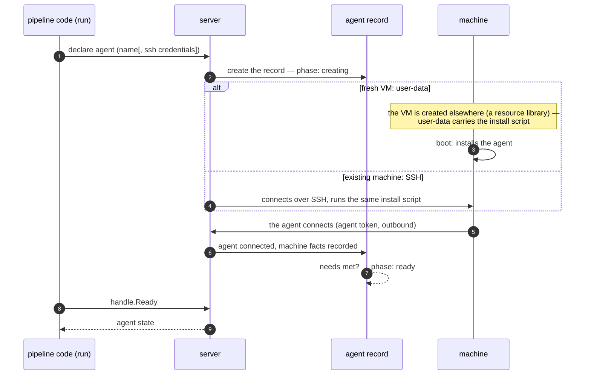
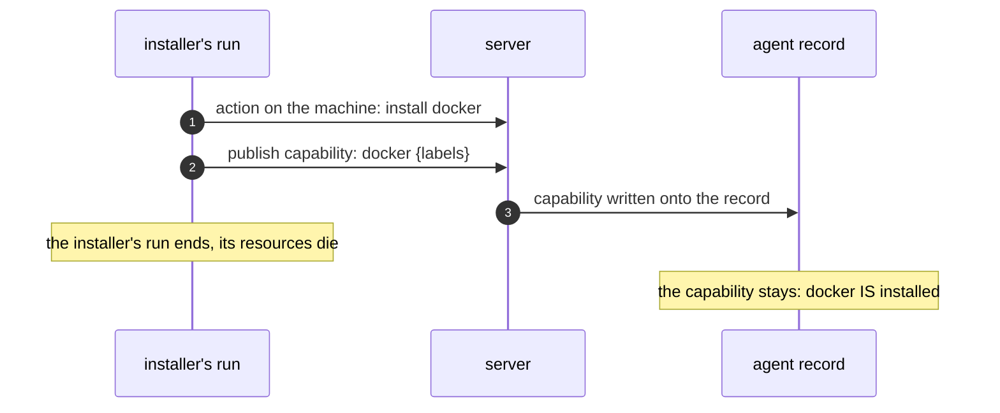

# Agents

## A process and a record

An agent is two things at once: a **process** on the user's machine
and a **resource** — the record linking the real machine to that
process. Declaring an agent never creates a machine: the record waits
for its agent to connect. The machine opens no ports; the agent
connects outward, with its own token.

How the agent gets onto the machine — two equal paths that converge
into the same connection:



Both paths run one and the same install script — two scripts would
drift.

## Capabilities are written, never discovered

What a machine CAN do is written onto its record by a publisher — an
installer, a person, a machine image. A capability has a name, labels,
an informative version, and a readiness flag. It belongs to the
machine, not to whoever published it:



## Readiness is one formula

An agent is ready when two conditions hold at once: the agent is
connected, and every need of the declaration is met — the required
capability is on the record, ready, and matches the label constraints.
`Ready` on the agent's handle waits for both: the refusal comes before
work is dispatched to the machine, not after it fails there.

Needs match capabilities by name plus label constraints — equality and
"one of". Versions are never compared.

## Selection and fan-out

Agents can be selected without knowing their names: a selector over
labels and needs returns a snapshot of the matching agents; an action
addressed to the set executes on every machine of the set.

## Leaks: a dirty machine

A record on a machine — a container, a volume, a file, a host setting —
removes what it put there when it is deleted. If the removal keeps failing
(the daemon stays away, a file will not go), the record still lets go, so one
stuck removal never blocks a cascade. What it left behind is written onto the
agent record as a **leak**: the record's reference, the error and the time.
The server takes the record and the machine from the deleting workflow
itself, never from what the caller claims.

A machine with leaks is dirty. The agent record lists up to 100 leaks; reports
past that are counted in `leaksOverflow`, never pushing a listed leak out. After
cleaning the machine, an operator clears one leak or all of them:

```bash
graphenectl invoke agent db-1 clear-leaks --data '{"ref":"docker/pg"}'
graphenectl invoke agent db-1 clear-leaks --data '{}'   # every leak and the overflow
```

## Foreign agents

An agent declared by someone else can be **attached**: recognized and
read like any handle, never created. An attached agent takes actions
like your own; the only difference — it cannot be a parent or a child
in the ownership tree.
