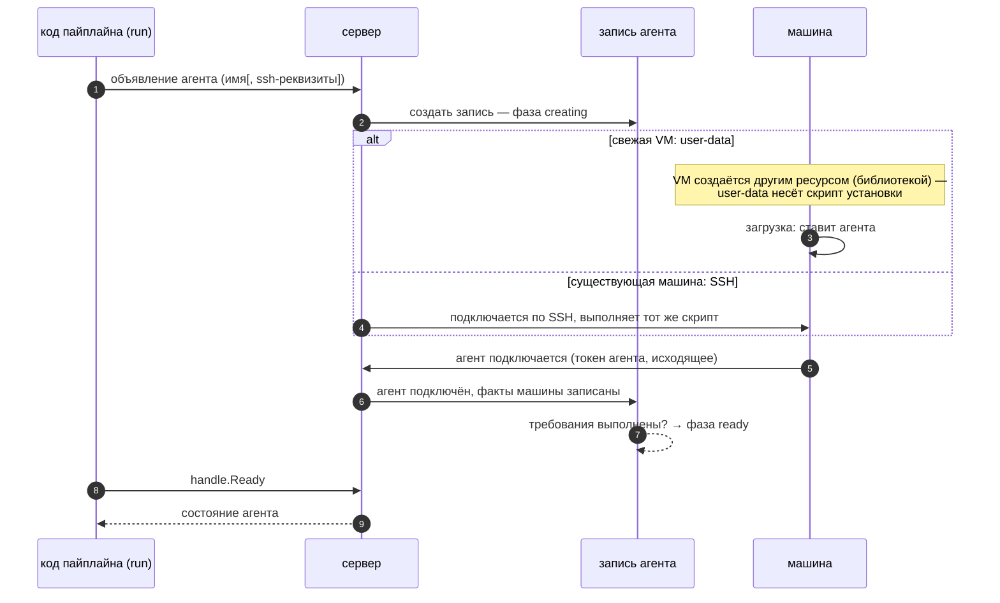
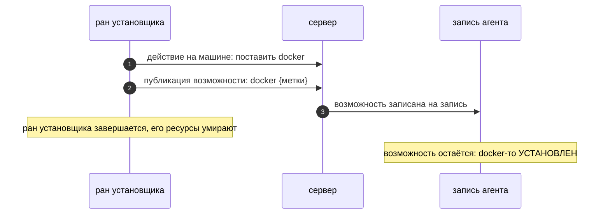

# Агенты

## Процесс и запись

Агент — две вещи сразу: **процесс** на машине пользователя и
**ресурс** — запись, связывающая реальную машину с этим процессом.
Объявление агента не создаёт машину: запись ждёт, пока её агент
подключится. Машина не открывает портов; агент подключается наружу,
со своим токеном.

Как агент попадает на машину — два равноправных пути, сходящихся в
одно подключение:



Оба пути выполняют один и тот же скрипт установки — два скрипта
разъехались бы.

## Факты: что такое машина

При подключении агент пишет на свою запись факты машины: hostname, ОС и
дистрибутив, CPU, память, интерфейсы с адресами и каждый физический диск — имя,
размер, вращение, шину, модель, серийный номер и его имена в
`/dev/disk/by-id`. Виртуальные устройства (loop, zram, device-mapper) не
попадают; что куда смонтировано — не факт, а [запись mount](../libraries/host.md#диски).
Факты — то, чем коробка является, прочитанное при подключении: ключ железа,
а не живое состояние.

## Возможности записываются, не обнаруживаются

Что машина УМЕЕТ — записано на её записи публикатором: установщиком,
человеком, образом машины. У возможности есть имя, метки,
информативная версия и признак готовности. Она принадлежит машине, а
не тому, кто её опубликовал:



## Готовность — одна формула

Готовность агента — два условия сразу: агент подключён, и каждое
требование объявления выполнено — нужная возможность есть на записи,
готова и проходит по меткам. `Ready` на хэндле агента ждёт оба
условия: отказ приходит до отправки работы на машину, а не после её
падения.

Требования матчатся с возможностями по имени плюс ограничениям на
метки — равенство и «одно из». Версии никогда не сравниваются.

## Выборка и веер

Агентов можно выбирать, не зная имён: селектор по меткам и
требованиям возвращает снапшот подходящих агентов; действие,
адресованное набору, выполняется на каждой машине набора.

## Утечки: грязная машина

Запись на машине — контейнер, том, файл, настройка хоста — при удалении
убирает то, что туда положила. Если удаление раз за разом не удаётся (демон
недоступен, файл не удаляется), запись всё равно отпускается: одно
застрявшее удаление не блокирует каскад. Оставленное пишется на запись
агента как **утечка**: ссылка на запись, ошибка и время. Запись и машину
сервер берёт из самого удаляющего workflow, а не из слов вызывающего.

Машина с утечками — грязная. Запись агента хранит до 100 утечек; отчёты
сверх этого считаются в `leaksOverflow` и не вытесняют уже записанные.
Убрав машину, оператор снимает одну утечку или все:

```bash
graphenectl invoke agent db-1 clear-leaks --data '{"ref":"docker/pg"}'
graphenectl invoke agent db-1 clear-leaks --data '{}'   # все утечки и переполнение
```

## Снять агента с машины

Удаление записи агента никогда не удаляет машину. Что оно делает с процессом
агента, решает запись — `pipeline.WithDecommission`:

| Политика | При удалении |
|---|---|
| нет (по умолчанию) | агент остаётся установленным: машину убирает её хозяин или она умирает со стендом |
| `DecommissionBestEffort` | агент удаляется до 15 минут; если не вышло, запись уходит, а `agentMayRemain` об этом говорит |
| `DecommissionGuaranteed` | запись остаётся в удалении, пока агент не удалён, — для машин, которыми Graphene не владеет |

Подключённый агент удаляет себя сам: запускает скрипт удаления сервера отдельным
systemd-юнитом и уходит из сессии. Неподключённого агента удаляют по ssh записи
тем же скриптом. Скрипт убирает то, что поставила установка, — сервис, бинарь,
`/etc/graphene-agent`, `/var/lib/graphene-agent`, учётку `graphene-run` — и не
трогает машину, привязанную к другому агенту; пакет `runc` остаётся. После
удаления записи её агент не пускается к серверу, каким бы токеном он ни владел.

## Чужие агенты

Агента, объявленного не вами, можно **присоединить**: распознать и
читать как любой хэндл, никогда — создать. Присоединённый агент
принимает действия как свой; единственная разница — он не может быть
родителем или ребёнком в дереве владения.
